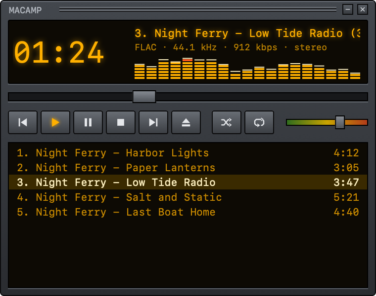
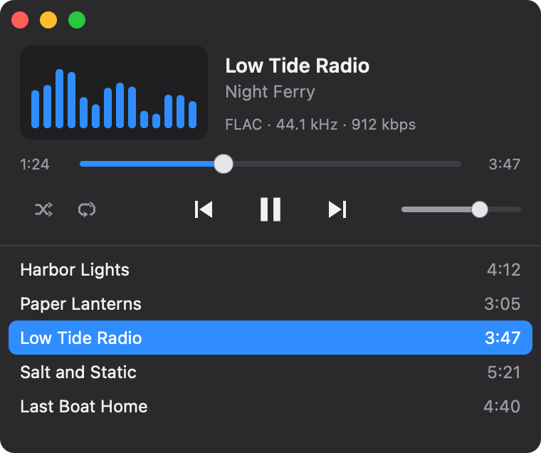

# macamp

A small Mac audio player in the spirit of late-90s desktop players: a compact
window, a playlist, and a spectrum display that moves with the music. It has
no library, no store, no network access and no dependencies beyond macOS.

Skins are plain JSON files that place and style every element in the window,
so the player can look however you like.

<p>
  
  
  
</p>

The three built-in skins: Phosphor, Rack Unit and Native Mini. Native Mini
follows the system's light and dark mode:

<p>
  
</p>

These pictures are drawn by the player's own `--render-skin` command with
sample tracks, not captured from a screen, so the window buttons are a
likeness. To regenerate one after changing a skin:

```
.build/debug/macamp --render-skin Phosphor --out docs/screenshots/phosphor.png
```

## Install

Download `macamp-<version>.zip` from the
[Releases page](https://github.com/sejordan/macamp/releases), unzip it, and
move `macamp.app` to your Applications folder. It needs macOS 14 or later and
runs on both Apple Silicon and Intel Macs.

The download is signed and notarized by Apple, so it opens like any other
app. The first time, macOS asks you to confirm that you want to open an app
downloaded from the internet.

## Build and run

Requires macOS 14 or later and the Xcode command-line tools.

```
scripts/build-app.sh        # builds build/macamp.app
open build/macamp.app
```

Copy `build/macamp.app` to `/Applications` if you want it there. A build made
this way is signed for the Mac that built it and opens there without any
extra steps.

`scripts/build-app.sh --universal --zip` builds for both Apple Silicon and
Intel and writes `build/macamp-<version>.zip`.

The release downloads are made the same way, with two settings added so the
result is signed for distribution and notarized by Apple. Both need an Apple
Developer account:

```
SIGN_IDENTITY="Developer ID Application: Your Name (TEAMID)" \
NOTARY_PROFILE=your-profile \
scripts/build-app.sh --universal --zip
```

`NOTARY_PROFILE` names credentials saved beforehand with
`xcrun notarytool store-credentials`.

For development:

```
swift build                 # debug build at .build/debug/macamp
swift test                  # the test suite
swift run macamp            # run without making an app bundle
```

## Using it

- **First launch:** the playlist starts with a short welcome track, so there
  is something to play. Remove it like any other row; it does not come back.
- **Add music:** drag files or folders onto the window or the Dock icon, use
  File > Open, or "Open With" in Finder. Folders are read recursively.
- **Formats:** MP3, AAC/M4A, ALAC, FLAC, WAV, AIFF and CAF.
- **Playlist:** double-click a row to play it. Drag rows to reorder them.
  Click, Shift-click and Command-click select rows; Delete removes them.
- **Visualizer:** click it to switch between spectrum bars and an oscilloscope.
- **Time readout:** click it to switch between elapsed and remaining time.
- The playlist, volume, skin and window position are remembered between
  launches. Closing the window quits the app.

### Keyboard

| Key | Action |
|---|---|
| Space | Play or pause |
| Left / Right | Seek back or forward 5 seconds |
| Up / Down | Volume |
| Z X C V B | Previous, play, pause, stop, next |
| Return | Play the selected row |
| Delete | Remove the selected rows |
| Command-Right / Command-Left | Next / previous track |
| Command-S / Command-R | Shuffle / repeat (off, all, one) |
| Command-O | Open files |
| Command-K | Clear the playlist |

The player also registers for the keyboard media keys and publishes the
current track to the system Now Playing panel.

## Controlling it from the command line

The same `macamp` binary can drive a running player, which makes it easy to
script and easy for an AI agent to operate. Put it on your path once:

```
ln -s /Applications/macamp.app/Contents/MacOS/macamp /usr/local/bin/macamp
```

```
macamp status                       # what is playing, position, volume
macamp play ~/Music/Some\ Album     # add a folder and start playing it
macamp play                         # resume
macamp pause | toggle | stop | next | previous
macamp jump 3                       # play track 3
macamp seek +30                     # also 90, 1:30, -10, 50%
macamp volume 60                    # also +5, -5
macamp add song.flac                # add without interrupting
macamp playlist
macamp remove 2 5                   # by track number
macamp clear
macamp shuffle on                   # on, off, toggle
macamp repeat all                   # off, all, one
macamp skin "Rack Unit"             # a built-in name or a skin file
macamp quit
```

- Every command prints the player's state afterwards, as one line for people.
  Add `--json` for a machine-readable reply with the full state.
- If no player is running, a command starts one in the background, without
  taking focus. `status` and `quit` do not start one.
- Exit status is 0 on success, 1 if the command failed (the reason goes to
  standard error, or into the `error` field with `--json`), 2 for bad usage,
  and 3 when `status` finds no player.
- `macamp song.mp3` with a player already running hands the file to that
  player instead of opening a second one.

The player listens on a socket file beside its saved state, in
`~/Library/Application Support/macamp/`, readable only by you. Nothing is
exposed on the network.

## Skins

Three skins are built in and listed in the Skin menu: **Phosphor**,
**Rack Unit** and **Native Mini**.

To make your own, start from a copy of a built-in skin and edit it. The player
watches the file and redraws every time you save:

```
M=build/macamp.app/Contents/MacOS/macamp
$M --copy-skin Phosphor ~/my-skin.json
$M --skin ~/my-skin.json
```

The full format reference is printed by `--skin-guide`. Other tools:

```
$M --validate-skin ~/my-skin.json                 # errors and warnings, each naming the exact field
$M --render-skin ~/my-skin.json --out preview.png # draw the skin to a picture without opening a window
$M --list-skins
$M --skin-schema                                  # JSON Schema for editors
```

Skin files placed in `~/Library/Application Support/macamp/Skins/` appear in
the Skin menu. You can also drop a skin file on the player window.

### Making skins with Claude

The format, error messages and tools are designed so an AI assistant can
author a skin without seeing your screen. In a Claude Code session, say what
you want and point it at the guide:

> Run `build/macamp.app/Contents/MacOS/macamp --skin-guide` and read it, then
> make me a skin that looks like a 1970s hi-fi receiver. Validate it and
> render a preview after each change, and look at the preview yourself.

Leave the player open with `--skin` on the same file to watch it change.

## Footprint

Measured on the packaged 0.1.0 app on an Apple Silicon Mac running macOS 15.7,
with `footprint` and `top`:

| Condition | Memory | CPU (one core) |
|---|---|---|
| Playing a FLAC, 1,000 tracks in the playlist, visualizer running | 23 MB | about 3% (1.6% to 4.3% across samples) |
| Stopped, same playlist loaded | 18 MB | 0% |

The release download is a 1.1 MB zip; the app inside is about 2 MB, since it
carries code for both Apple Silicon and Intel.

Paused, hidden and minimized were not measured separately. They take the same
path as stopped: the audio engine is paused and the redraw timer is off.

## Not yet checked by hand

The logic behind these is covered by tests, but nobody has tried them with a
real mouse, keyboard or screen yet:

- Dragging files, folders and skin files onto the window and the Dock icon.
- The menus and their shortcuts, and File > Open.
- The keyboard media keys and the Now Playing panel.
- Dragging and resizing the window, especially in the Rack Unit skin, which
  has no system title bar, and minimizing it.
- How the moving bars look on a real display. They are drawn in small overlay
  layers; their placement was checked by rendering, not by eye.
- Unplugging headphones or switching output device mid-song.

## Project layout

- `Sources/MacampCore`: everything that runs without a window: the skin
  parser and renderer, playlist and playback logic, saved state, the spectrum
  analyzer and the audio engine wrapper.
- `Sources/macamp`: the AppKit app and the command-line modes.
- `Sources/MacampCore/Resources`: the built-in skins, the skin guide and the
  JSON Schema, all embedded in the binary.

## Diagnostics

Two launch options help when checking the app without clicking through it:

- `--state <file.json>` keeps the saved playlist and settings in that file
  instead of `~/Library/Application Support/macamp/state.json`.
- `--snapshot <file.png> [--snapshot-after N]` writes a picture of the live
  window after N seconds, plus `<file.png>.json` with the player's status,
  then quits.
